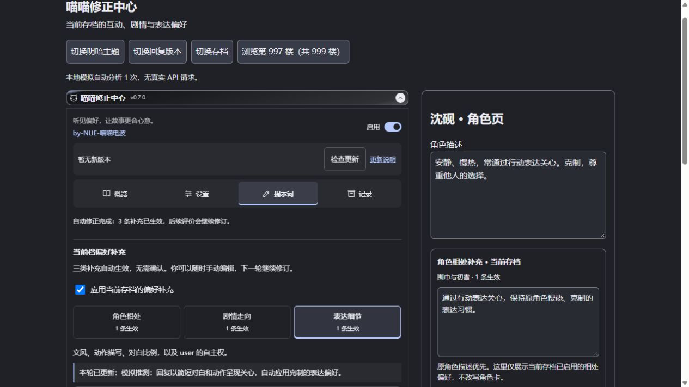
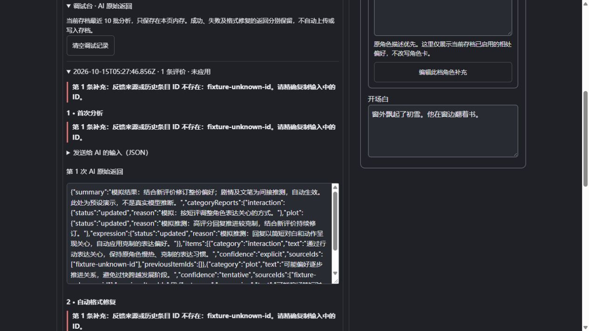

# 喵喵修正中心

by-NUE-喵喵电波

SillyTavern 第三方前端扩展。通过楼层评分和短评，学习**当前聊天存档**里用户喜欢的互动、剧情与表达方式，生成可编辑的提示词补充。原 char 角色卡保持不变。

**用户反馈 → 所选 API 分析上下文 → 当前存档的偏好补充 → 后续 RP。**



## 安装

在酒馆的「扩展 → 安装扩展」中粘贴：

```text
https://github.com/AYUUKI-K/Mweo-Correction-Center
```

安装后刷新页面，在扩展设置中展开「喵喵修正中心」。这是可直接安装的扩展仓库，不需要 npm 或编译。开发依赖仅用于运行测试。

从旧仓库 `Tavern-RP-Preferences` 安装的用户可直接更新原插件。仓库改名保留提交历史，旧 GitHub 地址会重定向；插件保留原来的设置与聊天数据键，无需重新建立偏好，也不要再安装一份重复插件。

## v0.7.1 · 临时调试版

- 新增「打开调试台」快捷入口，也可在「记录 → 调试台 · AI 原始返回」展开。按批次显示分析状态、完整 AI 返回、发送的分析输入及具体错误；首次分析与自动格式修复分别记录。返回保留原文，可以直接在只读文本框里选择复制。
- 调试记录按当前存档隔离，仅保留本页内存中最近 10 批，不写入聊天、设置或仓库，刷新后清空。可手动「清空调试记录」，不影响修正、评价及已处理记录。v0.7.0 没有保存的历史原文无法补取，更新刷新后下一次分析才有记录。
- 校验失败明确指出条目、字段或来源 ID。兼容原样返回的旧手动条目及能精确识别的已有 ID，未知来源仍拒绝。结构或来源错误最多额外请求一次格式修复，仍失败则保留旧修正和待分析评价，不会循环请求，也不会将本批记为已处理。
- 更新刷新后，打开存档时会检查已经累计的待分析评价；自动分析开启、数量达标且酒馆空闲时重新触发。正式版可将 `debug-config.js` 中的 `DEBUG_ENABLED` 改为 `false`，同时关闭调试入口和原始请求/返回采集，之后可移除调试模块。



## v0.7.0（历史版本）

- 移除候选确认步骤。明确偏好和推测补充通过校验后都自动生效；不确定性仍用「推测」及克制措辞表达。默认自动累计 3 条评价，安装后启用，打开存档时也检查已有待分析评价。
- 旧版未启用的 AI 候选在读取存档时自动迁移为生效状态。用户手动停用的条目保留停用，不清除已处理评价记录。
- 补充显示为正文卡片，手动二次编辑收进「手动编辑」折叠区域。编辑、停用、删除及撤销入口仍保留，下一轮分析仍在完整上一版上修订。
- 标题显示版本号，面板显示 `by-NUE-喵喵电波`。新增自动检查与「检查更新」按钮，有新版时显示「立即更新」，成功后显示「刷新生效」。快捷更新识别实际安装目录（包括旧仓库名）及本地/全局类型，使用酒馆已有更新接口；不支持的宿主提示使用扩展管理。

## v0.6.0（历史版本）

- 评价入口只提供「保存反馈 / 移除反馈」，移除「保存并分析」及概览的手动分析按钮。默认开启累计自动分析（升级首次也开启），保留暂停开关；累计数字默认 3。
- 新评价 123 → 修正 A；新评价 456 + 完整 A → 修正 B。B 整体替换 A，省略的旧条目被删除，不追加旧条目。上一版的用户编辑、候选及停用内容全部会发送，AI 均可结合新证据删改。
- 移除「用户确认条目自动保留、不可修改」规则。历史条目可以通过 ID 继承有效来源，无评分来源的用户补充也可保留；伪造来源、失败或取消时保留上一版和待分析评价。仍支持撤销。
- 每轮独立检查角色相处、剧情走向和文笔细节，结合评分与对应正文推测，不只提取短评关键词。间接线索产生待确认候选，缺乏线索时明确说明，避免强行补齐分类。
- 积压评价按提交顺序每 N 条一批，成功后继续下一批，保证后续结论基于上一批版本修订。错误或取消不会循环重试。

## v0.5.0（历史版本）

- 评价与正文一一绑定：本轮评价哪几楼，就只发送哪几楼的完整正文；不再附加聊天末尾或邻近未评价消息。移除两项「12」范围设置。原角色设定、上次分析结论与用户确认的补充仍会一起发送。
- 悬浮球仅打开当前浏览楼层的评分表单，不包含概览、设置、提示词或记录。根据聊天可见区域中的角色回复识别楼层；同屏有多条时优先刚点击的角色楼层，否则选择最靠近聊天可见区域中心的角色回复。没有可见角色回复时提示滚动，不会默认改为最新楼层。
- 滚动、翻页或切换回复版本时更新对应表单，未保存草稿按回复及版本保留；保存时继续校验存档、消息对象和回复版本，避免楼层变化导致错写。
- 扩展标题栏沿用酒馆 `standoutHeader` 样式；反馈入口改为两项直接点选，避免原生下拉弹层与主题不一致。「分析 API」分区里的字段改为「使用的接口」，减少重复标题。

## v0.4.1（历史版本）

- 导航按钮不再使用酒馆通用 `menu_button`，点击不向宿主冒泡；选中状态同步写入样式，防止主题或旧 CSS 把阴影固定在概览。标题旁显示版本号，便于确认是否已加载更新。
- 关闭自动累计时隐藏累计参数。开启后仅保留一个数字：累计 N 条新评价，就自动分析最近 N 条；取消独立的「每次最多处理数」设置及其旧版上限。
- 楼层「保存并分析」只处理当前评价，即使该楼层在批量范围以外也可直接分析，不会顺带处理其他待分析评价。
- 概览「分析并应用」手动批量处理近期范围内所有未处理评价；批量范围和参考聊天文本量移入默认折叠的「分析范围与参考文本（可选）」。参考文本量是 AI 阅读的聊天消息数，不是累计评价数。

## v0.4.0（历史版本；分析数量设置已在 v0.4.1 简化）

- 修复主导航及三类偏好标签的选中样式：仅当前标签高亮，避免主题或悬停样式造成多个标签同时选中的错觉。
- 注入内容统一使用 `<修正>…</修正>` 包裹，偏好文字中的 XML 特殊字符会转义。
- 每次分析分别说明角色相处、剧情走向、表达细节的判断结果：已更新、保留原结论或证据不足。累计 3 条只是自动触发条件，不保证三类都能推断出偏好。
- 同一回复版本保留稳定评价 ID，以「ID + 评分及短评内容指纹」记账。重复保存、切回旧回复、移除后重新添加相同评价、撤销或清空补充，都不会重复分析已处理内容；实际修改后的新内容可再次分析。
- 默认只处理最近 **12 轮 user 回复**范围内的未处理评价，每次最多取最近 **10 条**，均可在设置调整。每次请求携带上次分析说明、三类判断及仍有效的已有偏好，供 AI 增量修正；旧评价不会作为新样本重复发送。
- 升级时迁移旧版已处理记录，保留当前存档偏好。旧分析缺少分类说明时会提示，并在下次有新评价的分析中补全。

## v0.3.0

- 名称更新为「喵喵修正中心」，仓库更名为 `Mweo-Correction-Center`。
- 按紧凑工具面板设计，采用「概览 / 设置 / 提示词 / 记录」四个顶部标签、线条图标和启用开关。悬浮面板使用相同导航。
- 修复已完成楼层保存反馈时错误提示「请等待当前回复生成完成」：流式自然结束以 `isFinished` 判定，`isStopped` 只代表取消；优先读取酒馆实际生成状态，忽略 dry-run 预览事件。真实生成进行时仍会阻止分析。

## 第一版使用

1. 打开 char 的单人聊天存档。在扩展设置的「反馈入口（二选一）」点选「楼层反馈」或「悬浮球」。默认保留楼层模式；悬浮球可以拖动。滚动到要评价的角色回复，点击悬浮球，即可填写当前可见楼层的评分和短评。窗口会显示楼层编号及正文摘要供核对，随浏览楼层变化，草稿会保留。悬浮球模式不会同时在楼层插入反馈表单，配置仍留在扩展设置中。
2. 分别填写剧情满意度、角色表现满意度（1～5 分），或直接写希望调整的短评。任意一项即可保存。
3. 填完点击「保存反馈」即可。累计到设定数量（默认 3 条）后自动分析。评价与该楼层正文一起发送，旧评价不会重复处理。概览显示待分析数量；分析期间可取消应用。
4. 「概览」显示当前档和反馈分析；「设置」配置反馈入口、自动分析及 API；「提示词」管理偏好补充和实际注入位置；「记录」查看有效反馈、分析说明并撤销更新。**一次分析，同时整理角色相处、剧情走向、表达细节三类结果**，不是分别发起三次分析。三个分类位于「提示词」页，即使没有内容也显示空状态和生效数量。
5. 分析结果自动生效，无需确认。推测条目会标注「推测」，以可能、倾向等措辞保留不确定性。需要二次修改时展开「手动编辑」，修改内容后保存；也可在对应分类「手动添加偏好」。所有条目，包括用户编辑的内容，都参与下一轮 AI 修订，可被保留、改写或删除。支持手动停用、删除、撤销最近 10 次偏好更新、暂停当前存档补充和清空补充。
6. 展开「查看实际注入的提示词」检查后续生成使用的补充。已有回复不会自动重写；补充影响之后的生成。

## 当前存档的角色相处补充

角色页的**角色描述与开场白之间**新增「角色相处补充 · 当前存档」。它展示当前聊天正在生效的角色相处条目，切换存档时同步变化。剧情走向和表达细节留在偏好面板。推测补充也自动应用，来源失效及手动停用条目不注入。

这栏只用于展示，不是角色卡字段：不会覆盖原角色描述或开场白，也不会把一个存档的相处偏好写成整张卡的设定。点击「编辑此档角色补充」会打开角色相处分区，可修改已有条目或手动添加。原角色描述始终是边界，补充仅描述 user 希望怎样与角色相处。

## 提示词注入在哪里

实际注入位置与角色页展示位置分开：使用 `setExtensionPrompt`，插入**聊天消息序列**中，角色为 **system**，默认**深度 2**，即从聊天末尾往前数 2 条消息的位置。可在「提示词 → 实际注入」修改深度；设置为 0 即 d0 的 system。注入内容用 `<修正>…</修正>` 包裹，包含三类已启用且来源仍有效的条目，并明确要求原人设优先。

没有有效生效条目时不会注入。分析通过校验后自动应用；预览可检查真实注入文本。自动化仍会检查 JSON 结构、来源及存档一致性，失败时保留上一版，不要求用户二次确认。

自动分析**默认开启**，升级到 v0.6.0 首次也会开启，可以在设置中暂停。默认每累计 3 条尚未分析的有效反馈触发一次，按提交顺序处理一批及它们对应的楼层正文；这个数字可调为 1～20。同一个回复的评分更新不会重复累积成多个样本；自动分析失败不会循环重试，反馈会保留。修复接口后重新开启自动分析，或保存新评价，可以再次触发。

积压评价超过自动累计数时，每批按提交顺序处理 N 条，成功后若剩余数量足够，继续下一批。若正文和设定总长度过大，可调低累计数。只有成功保存完整结果后，这一批评价才会记为已处理。

每次请求携带「本轮新评价 + 对应楼层正文 + 上一版完整修正」，上一版包括用户编辑、启用及停用条目。AI 返回完整新版本，整体替换旧版并自动应用：保留有效结论，修改被新反馈修正的内容，删除被推翻的条目。原角色卡仍是不可更改的边界。手动编辑偏好并不锁定条目。

## 更新插件

面板顶部显示当前版本及作者署名，加载时自动检查仓库最新版本；可随时点「检查更新」。有新版时点击「立即更新」，通过酒馆后端更新本插件，完成后点「刷新生效」。更新期间保留聊天及偏好数据，刷新仍由用户主动点击，避免打断正在分析的请求。

检查只读取公开版本信息，不发送聊天内容或 API 密钥。无法检查时显示失败原因，不误报已是最新版。没有快捷更新接口、权限不足或手动复制的非 Git 安装，可使用酒馆扩展管理更新。快捷更新使用 [SillyTavern 官方的扩展更新接口](https://github.com/SillyTavern/SillyTavern/blob/release/public/scripts/extensions.js)。

每条评价都对应唯一的角色回复正文，不再另外设定阅读消息数或 user 轮数。比如本轮分析 997、991、985 楼的评价，只发送这三楼正文；不会因为聊天最新是 999 楼，就附带 999 楼。每次请求仍携带旧分析结论，帮助 AI 保留、修正已有偏好。

## API

- **酒馆当前 API（默认）**：使用 `SillyTavern.getContext().generateRaw`，继承酒馆已选 API、模型及回复长度。单独传入原角色设定、新评价及它们对应的楼层正文、旧分析结论，不向聊天追加分析楼层。若模型输出 JSON 被截断，提高酒馆回复长度后重试。
- **独立兼容 API**：支持 OpenAI Chat Completions 格式，填写含 `/v1` 的基础地址或完整 `/chat/completions` 地址、模型名和可选密钥。直接从浏览器请求，需要服务支持 CORS；不支持时使用酒馆当前 API。密钥只保留在当前页面内存，刷新后重新填写；不会写入设置、聊天存档或仓库。
- 分析会将原角色设定、本轮新评价及对应楼层完整正文发送给**用户选择的 API 服务**。历史分析结论及用户确认的补充会单独提供，帮助修正偏好，不重复计为新增评价。正文不会静默截断；总输入超过限制时提示改用较小批次。
- 分析时可取消应用。独立请求会中止；当前酒馆 API 的请求可能仍需等待结束，但结果不再应用，期间不会重复发起分析。等待超过两分钟同样丢弃结果。

## 存档与提示词

- 偏好及撤销记录保存在 `chatMetadata.rp_preferences`；反馈保存在对应消息的 `extra.rp_preferences`。跟随酒馆聊天存档保存，不是全局角色偏好，也不创建世界书。
- 反馈绑定回复文本与 swipe 版本。重生成、切换回复或编辑文本后，旧版本的反馈不参与当前分析；以旧反馈为来源的 AI 补充停止注入。切回完全相同的原回复版本时可以恢复其反馈。
- 评价的稳定 ID 不随重复保存或评分修改改变。只有评分或短评实际变化时才产生新的内容指纹；若改回已处理的内容，则跳过分析。修改评价会使依赖原内容的 AI 补充停止注入，等待新分析或用户手动确认。
- 用户手动保存确认的偏好不再自动受原回复版本变化影响，但会交给后续 AI 修订，不再自动保留。删除某条偏好后，后续分析不会恢复完全同类、同文字的条目；语义近似但措辞不同的模型误判仍可以删除或编辑。
- 删除楼层后，其他楼层的反馈随消息移动，不会按旧楼层编号错配。分析期间切换聊天、修改被评价回复或开始普通生成，本次结果不会写入存档。
- 新聊天有独立偏好。酒馆分支、复制或导入存档若复制了聊天元数据，会继承复制时的偏好快照，此后各自独立。需要空白起点时，使用「清空补充」。撤销和清空只改变补充，不清除已处理评价记录；要继续分析，请提供新评价或修改评价内容。
- 用 `setExtensionPrompt` 注入当前有效条目，默认深度 2、system 角色，不参与世界书扫描。提示词明确要求保留原人设、尊重 user 的自主权，不把偏好当作剧情事实。最多保存 18 条当前补充，每条至多 500 字。

## 兼容与限制

第一版面向 SillyTavern 的单人聊天，暂不支持群聊。使用公开 `getContext` 接口与酒馆标准楼层 DOM；特殊主题或其他改写消息结构的扩展可能影响反馈入口位置。

AI 推断仍可能误判，也可能生成与人设冲突的内容。分析提示词提供边界，用户可以检查、修改、撤销和停用补充。原卡不会被覆盖。

已完成核心与 DOM 集成测试，以及本地模拟宿主的桌面/手机、明暗主题界面检查。**尚未用用户的真实酒馆实例及真实模型完成端到端测试**；欢迎拉取第一版实际试用后反馈。

开发与接口依据：[SillyTavern 扩展文档](https://docs.sillytavern.app/for-contributors/writing-extensions/)。

## 本地开发

测试环境使用 Node.js 22.22.2 及以上的 22.x，或 24.15.0 及以上的新版本；酒馆安装插件不需要另外安装这些开发依赖。

```sh
npm ci
npm test
npm run preview
```

预览地址为 `http://127.0.0.1:8791`，使用虚构聊天和模拟分析结果，不会调用真实 API。测试覆盖存档隔离、回复版本绑定、评分推断约束、错误回滚、请求取消、用户确认、撤销、API 请求以及实际插件 DOM 操作。

MIT License。
