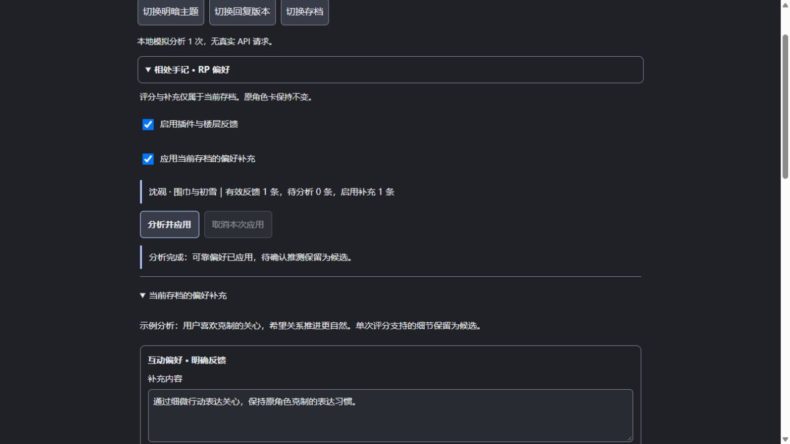

# 相处手记 · RP 偏好

SillyTavern 第三方前端扩展。通过楼层评分和短评，学习**当前聊天存档**里用户喜欢的互动、剧情与表达方式，生成可编辑的提示词补充。原 char 角色卡保持不变。

**用户反馈 → 所选 API 分析上下文 → 当前存档的偏好补充 → 后续 RP。**



## 安装

在酒馆的「扩展 → 安装扩展」中粘贴：

```text
https://github.com/AYUUKI-K/Tavern-RP-Preferences
```

安装后刷新页面，在扩展设置中展开「相处手记 · RP 偏好」。这是可直接安装的扩展仓库，不需要 npm 或编译。开发依赖仅用于运行测试。

## 第一版使用

1. 打开 char 的单人聊天存档。在任意角色回复下展开「反馈」。
2. 分别填写剧情满意度、角色表现满意度（1～5 分），或直接写希望调整的短评。任意一项即可保存。
3. 「保存反馈」只存反馈；「保存并分析」会立即调用 API。「分析并应用」分析当前存档累计的新反馈。
4. 在扩展设置中查看三类补充：**互动偏好、剧情偏好、表达偏好**。明确反馈和多次支持的规律默认启用，单次或不确定推测保留为未启用的候选。
5. 候选可以勾选启用并「保存修改」。保存后的条目视为用户确认，后续分析会保留。支持删除、撤销最近 10 次偏好更新、暂停当前存档补充和清空补充。
6. 展开「查看实际注入的提示词」检查后续生成使用的补充。已有回复不会自动重写；补充影响之后的生成。

自动分析**默认关闭**。在「分析与 API 设置」开启后，默认每累计 3 条尚未分析的有效反馈触发一次，阈值可调为 1～20 条。同一个回复的评分更新不会重复累积成多个样本；自动分析失败不会循环重试，反馈会保留供手动重试。

## API

- **酒馆当前 API（默认）**：使用 `SillyTavern.getContext().generateRaw`，继承酒馆已选 API、模型及回复长度。单独传入原角色设定、反馈、被评价楼层附近上下文和最近上下文，不向聊天追加分析楼层。若模型输出 JSON 被截断，提高酒馆回复长度后重试。
- **独立兼容 API**：支持 OpenAI Chat Completions 格式，填写含 `/v1` 的基础地址或完整 `/chat/completions` 地址、模型名和可选密钥。直接从浏览器请求，需要服务支持 CORS；不支持时使用酒馆当前 API。密钥只保留在当前页面内存，刷新后重新填写；不会写入设置、聊天存档或仓库。
- 分析会将原角色设定、反馈与相关聊天片段发送给**用户选择的 API 服务**。最近上下文默认 12 层，范围可调。旧楼层的有效反馈也会带上对应回复及附近内容。
- 分析时可取消应用。独立请求会中止；当前酒馆 API 的请求可能仍需等待结束，但结果不再应用，期间不会重复发起分析。等待超过两分钟同样丢弃结果。

## 存档与提示词

- 偏好及撤销记录保存在 `chatMetadata.rp_preferences`；反馈保存在对应消息的 `extra.rp_preferences`。跟随酒馆聊天存档保存，不是全局角色偏好，也不创建世界书。
- 反馈绑定回复文本与 swipe 版本。重生成、切换回复或编辑文本后，旧版本的反馈不参与当前分析；以旧反馈为来源的 AI 补充停止注入。切回完全相同的原回复版本时可以恢复其反馈。
- 用户手动保存确认的偏好不再自动受回复版本变化影响。删除某条偏好后，后续分析不会恢复完全同类、同文字的条目；语义近似但措辞不同的模型误判仍可以删除或编辑。
- 删除楼层后，其他楼层的反馈随消息移动，不会按旧楼层编号错配。分析期间切换聊天、修改被评价回复或开始普通生成，本次结果不会写入存档。
- 新聊天有独立偏好。酒馆分支、复制或导入存档若复制了聊天元数据，会继承复制时的偏好快照，此后各自独立。需要空白起点时，使用「清空补充」。
- 用 `setExtensionPrompt` 注入当前有效条目，默认深度 2、system 角色，不参与世界书扫描。提示词明确要求保留原人设、尊重 user 的自主权，不把偏好当作剧情事实。最多保存 18 条当前补充，每条至多 500 字。

## 兼容与限制

第一版面向 SillyTavern 的单人聊天，暂不支持群聊。使用公开 `getContext` 接口与酒馆标准楼层 DOM；特殊主题或其他改写消息结构的扩展可能影响反馈入口位置。

AI 推断仍可能误判，也可能生成与人设冲突的内容。分析提示词提供边界，用户可以检查、修改、撤销和停用补充。原卡不会被覆盖。

已完成核心与 DOM 集成测试，以及本地模拟宿主的桌面/手机、明暗主题界面检查。**尚未用用户的真实酒馆实例及真实模型完成端到端测试**；欢迎拉取第一版实际试用后反馈。

开发与接口依据：[SillyTavern 扩展文档](https://docs.sillytavern.app/for-contributors/writing-extensions/)。

## 本地开发

```sh
npm ci
npm test
npm run preview
```

预览地址为 `http://127.0.0.1:8791`，使用虚构聊天和模拟分析结果，不会调用真实 API。测试覆盖存档隔离、回复版本绑定、评分推断约束、错误回滚、请求取消、用户确认、撤销、API 请求以及实际插件 DOM 操作。

MIT License。
